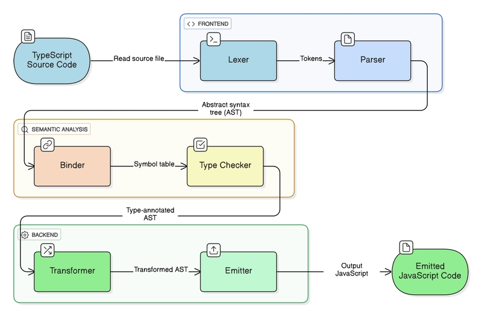

# 01_Basics - 02

Read Docs:
https://www.typescriptlang.org/docs/handbook/typescript-in-5-minutes.html


# JavaScript & TypeScript Data Types

1. Primitive Data Types (JavaScript)

| Data Type | TypeScript Syntax | Example | Description |
|---|---|---|---|
| Number | `number` | `let age: number = 21` | Stores integers and decimal numbers. |
| String | `string` | `let name: string = "Prithvi"` | Stores text and characters. |
| Boolean | `boolean` | `let isActive: boolean = true` | Stores `true` or `false`. |
| Undefined | `undefined` | `let x: undefined = undefined` | Represents an unassigned value. |
| Null | `null` | `let x: null = null` | Represents an intentional absence of value. |
| BigInt | `bigint` | `let x: bigint = 100n` | Stores integers larger than the safe Number limit. |
| Symbol | `symbol` | `let id: symbol = Symbol("id")` | Creates unique identifiers. |

2. Non-Primitive Data Types (JavaScript)

| Data Type | TypeScript Syntax | Example | Description |
|---|---|---|---|
| Object | `object` / object type | `let user: { name: string }` | Stores data in key-value pairs. |
| Array | `number[]` | `let nums: number[] = [1, 2, 3]` | Stores multiple values in an ordered collection. |
| Tuple | `[string, number]` | `let user: [string, number] = ["John", 21]` | Stores values with fixed positions and types. |
| Function | `(a: number) => number` | `let add: (a: number) => number` | Represents reusable functions. |
| Date | `Date` | `let today: Date = new Date()` | Handles dates and time. |
| RegExp | `RegExp` | `let pattern: RegExp = /hello/i` | Handles pattern matching. |
| Map | `Map<K, V>` | `let map: Map<number, string>` | Stores key-value pairs. |
| Set | `Set<T>` | `let set: Set<number>` | Stores unique values. |
| WeakMap | `WeakMap<K, V>` | `let map: WeakMap<object, string>` | Stores weakly referenced object keys. |
| WeakSet | `WeakSet<T>` | `let set: WeakSet<object>` | Stores weakly referenced objects. |
| Promise | `Promise<T>` | `let p: Promise<string>` | Handles asynchronous operations. |
| Error | `Error` | `let err: Error = new Error()` | Represents runtime errors. |

3. Special Types in TypeScript

| Type | Example | Description |
|---|---|---|
| any | `let value: any = 10` | Accepts any type and disables type checking. |
| unknown | `let value: unknown = "Hello"` | Accepts any value but requires type checking before use. |
| never | `function error(): never { throw new Error() }` | Represents a value that never occurs. |
| void | `function greet(): void {}` | Represents no meaningful return value. |
| Union | `let value: string \| number` | Allows multiple possible types. |
| Intersection | `type A = User & Admin` | Combines multiple types. |
| Literal | `let direction: "left" \| "right"` | Restricts values to specific literals. |

4. Key Differences

| Feature | Primitive | Non-Primitive |
|---|---|---|
| Stores | Single values | Collections or complex data |
| Mutability | Immutable values | Objects can be mutated |
| Assignment | Copies the value | Copies the reference |
| Comparison | Compares values | Usually compares references |
| Examples | Number, String, Boolean | Object, Array, Function |

> **Note:** JavaScript has 7 primitive data types. Arrays, functions, dates, maps and sets are all objects. TypeScript adds a static type system and additional type constructs on top of JavaScript.

---

# How TypeScript Works Internally



There are 3 main stages:
1. Frontend
2. Semantic Analysis
3. Backend

## 1. Frontend – Understanding your code

TypeScript Passes the main source file (ex: file.ts) to lexer

>**Lexer**
- Lexer reads your TypeScript source code
- breaks it into small pieces called as __Tokens__

| code | tokens |
|---|---|
|let age: number = 21 | let
|---| age
|---| :
|---| number
|---| =
|---| 21

---

>**Parser**
- Takes those tokens
- Understands how they are connected

Then creates something called an AST (
[Abstract Syntax Tree](https://www.google.com/search?q=what+is+abstract+syntax+tree&oq=What+is+Abstract+synt&gs_lcrp=EgZjaHJvbWUqBwgAEAAYgAQyBwgAEAAYgAQyCggBEAAYgAQYtAcyBggCEEUYOTIKCAMQABiABBi0BzIKCAQQABiABBi0BzIICAUQABgWGB4yCAgGEAAYFhgeMggIBxAAGBYYHjIICAgQABgWGB4yCAgJEAAYFhge0gEINDU2MWowajeoAgCwAgA&sourceid=chrome&source=chrome.ob&ie=UTF-8) ).

For Example
```
let age: number = 21
```

The Parser understands that:
- let declares a variable.
- age is the variable name.
- number is its type.
- 21 is its assigned value.

## 2. Semantic Analysis – Checking your code

>**Binder**

The Binder creates a __Symbol table__.

A symbol table is basically a record of the identifiers (variables, functions, classes, etc.) declared in your code.

Identifier| Type
--- | ---
age	| number
name |	string

It helps TypeScript understand where variables are declared and where they can be accessed.

---
>**Type Checker**

The Type Checker checks whether you're using values with the correct types.

Example:
```
let age: number = 21;
age = "Prithvi"; // Error!
```

It also checks things like:
- Whether function arguments have the correct types.
- Whether object properties exist.
- Whether interfaces and types are being followed.
- Whether operations are valid for the given types.

## 3. Backend – Generating JavaScript

>**Transformer**

The Transformer modifies the AST into a form suitable for JavaScript output.
For example, it removes TypeScript-only syntax, such as type annotations.

Input:
```
let age: number = 21;
```

After transformation:
```
let age = 21;
```

Note: JavaScript doesn't understand TypeScript's type annotations.

---

> **Emitter**

The Emitter takes the transformed code and generates the final JavaScript file.

For example:

TypeScript input:
```
interface User {
    name: string;
    age: number;
}

const user: User = {
    name: "Prithvi",
    age: 21
};
```


Emitted JavaScript:
```
const user = {
    name: "Prithvi",
    age: 21
};
```